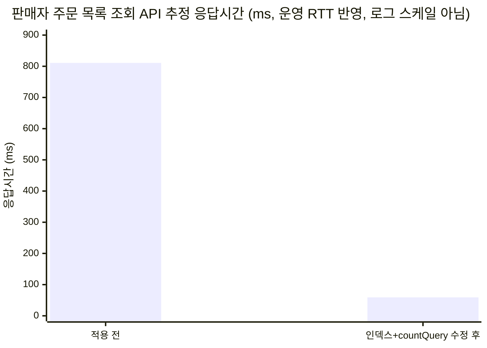

# GRAB — 한정 판매(DROP) 이커머스 플랫폼

> 부트캠프 최종 프로젝트, 4인 팀. 이 README는 팀원 중 **sangmin(sang9831)** 이 자신의
> 작업을 기준으로 정리한 개인 포트폴리오용 문서다.

## 프로젝트 소개

GRAB은 "기다림은 짧게, 기회는 단 한 번"을 컨셉으로 한 한정 수량 판매(DROP) 커머스
서비스다. 구매자는 관심 있는 DROP을 WISH(찜)해두고 오픈 알림을 받아 구매까지
이어가고, 판매자는 사업자 심사를 통과한 뒤 DROP을 등록·판매하고 대시보드에서
주문·배송·재고 현황을 관리한다. 재고 동시성, 결제 연동, 실시간 재고 스트리밍(SSE)
등 트래픽이 몰리는 "오픈 순간"을 견디는 것이 핵심 과제였다.

## 담당 역할

**판매자(셀러) 도메인 백엔드 + 배포/인프라**를 담당했다.

- 판매자 등록 신청·심사(국세청 사업자등록 상태조회 연동, 서류 암호화 저장) API
- 판매자 대시보드(요약 통계, DROP별 판매 통계, 임박 DROP) API
- 판매자 주문·배송 조회/처리 API, 배송 단계 Mock 자동 진행
- WISH 알림 메일(판매 임박/시작/취소) 발송
- k6 부하테스트 설계·실행(DB 인덱스, 쿼리 합치기, 동시성 제한 등 성능 개선)
- Nginx Blue/Green 무중단 배포 + GitHub Actions CD, Grafana/Prometheus 모니터링

## 기술 스택

<p>
  
  
  
  
  
  
  
  
  
  
  
</p>

## 핵심 구현 내용

### 1. 판매자 심사 자동화 — 국세청 사업자등록 상태조회 API 연동

판매자 등록 신청 시 사업자등록번호를 1차 검증하기 위해 공공데이터포털의 국세청
사업자등록 상태조회 API(진위확인이 아닌 상태조회, `b_no`만 전달)를 호출하는
`BusinessRegistrationVerifier` 인터페이스와 `NtsBusinessRegistrationVerifier` 구현체를
추가했다. 기존 `TossPaymentGateway`/`SupabaseStorageClient`와 동일하게
`RestClient` + `JdkClientHttpRequestFactory` 패턴을 따랐고, 재시도·서킷브레이커는 두지
않는 대신 외부 API 장애 시 예외를 던지지 않고 `UNAVAILABLE`로 분류해 호출부가 심사를
생략하고 신청을 `PENDING`으로 접수하게 했다(SELLER-005 요구사항).

운영 중 발견·수정한 문제들:
- 서비스키의 `+`가 쿼리 문자열에 직접 들어가면 URL 인코딩되지 않아 키가 깨지는 문제 →
  URI 템플릿 변수로 바꿔 해결.
- 응답 `data` 배열의 첫 항목이 `null`인 경우 NPE가 그대로 호출부까지 전파되던 문제 →
  가드 추가.
- "01이 아니면 전부 폐업(INACTIVE)"으로 단정하던 분류 로직을 "알려진 코드(02·03·빈
  값)만 INACTIVE, 그 외 미확인 코드는 UNAVAILABLE"로 변경해, API 스펙 변경이나 버그로
  생긴 낯선 상태코드 때문에 정상 사업자가 오판정되는 것을 막음.

### 2. 민감 서류(사업자등록증 등) 암호화 저장

판매자가 제출하는 서류는 파일마다 랜덤 생성한 DEK(Data Encryption Key)로
**AES-256-GCM** 암호화하고, 그 DEK는 환경변수로 주입한 마스터 키로 한 번 더 암호화해
함께 저장하는 **봉투 암호화(envelope encryption)** 방식을 적용했다(`DocumentEncryptionService`).
IV(12바이트)는 매 호출 `SecureRandom`으로 새로 생성해 암호문 앞에 이어붙이고,
GCM 태그(128비트)로 변조 여부를 검증한다. 암호문은 비공개 Supabase Storage 버킷에
`DocumentStorage` 인터페이스를 통해 저장하며, `ImageStorage`와 달리 공개 URL을 발급하지
않는다.

서류 열람은 운영자 전용이며, presigned URL을 내려주지 않고 매 요청마다 서버가
복호화 + 워터마크(열람자·시각) 합성까지 끝낸 이미지 바이트를 직접 응답하는
`SellerDocumentViewService`를 만들었고, 열람 시도를 `SellerDocumentAccessLog`에 남긴다.
프론트엔드에는 서류 열람 토글·캡처 방지용 마찰(우클릭/드래그 방지 등)도 함께 추가했다.

### 3. 판매자 대시보드 / 주문·배송 관리

- 대시보드 요약(상태별 DROP·주문·결제 건수, 정산 필요 건수, 재고 합계)과 DROP별
  판매·재고 통계(LATERAL 조인 기반), 임박 DROP 목록 API.
- 판매자 주문 목록(`findSellerOrders`)/상세 조회, 배송 등록·배송 단계 전이 API.
- `SHIPPED` 이후 배송 단계를 자동으로 진행시키는 Mock 스케줄러(운영 결제·배송사 연동
  전, 실제 흐름처럼 상태가 바뀌도록 구현).
- 판매자가 DROP을 취소하거나 WISH한 DROP이 판매 임박/시작될 때 구매자에게 메일을
  발송하는 알림 기능.

### 4. k6 부하테스트 기반 성능 개선

"캐시나 인덱스를 추가하기 전에 먼저 부하테스트로 병목을 확인한다"는 팀 원칙에 따라
판매자 주문/대시보드 조회, DB 커넥션 풀 고갈, 로그인 폭주, 결제 배치 soak, PG 장애
주입, WISH 메일 폭주, 드롭 상태 전이 배치, 배송 진행 배치 soak 등 다수의 k6 시나리오를
설계·작성했다(`Backend/k6/`). 운영 환경(t3.small 추정)보다 열악한 t3.nano/micro
스펙으로 제한한 로컬 Docker 환경에서 측정해, "이 정도로 약한 환경에서도 재고
동시성이 깨지지 않는가"를 기준으로 삼았다.

대표적으로 판매자 주문 목록 조회에서 발견한 두 단계 병목을 아래 "성능 개선" 절에
정리했다. 그 외에도 주문 생성 시 재고 잠금(lock)과 재고 증가(increase) 쿼리를
조건부 `UPDATE ... RETURNING` 하나로 합쳐 트랜잭션의 락 보유 구간에서 DB 왕복을 1회
줄였고(GR-202), 드롭 오픈 스파이크가 무관한 트래픽까지 느려지게 만드는 것을 막기 위해
주문 생성 동시 실행 전역 상한(세마포어, acquire-timeout 3초 → 503 반환)을 두고
`maxConcurrent` 값(10/15/20/100)을 바꿔가며 재측정해 20을 최적값으로 선택했다.

### 5. Nginx Blue/Green + GitHub Actions 기반 무중단 배포

`Backend/deploy/deploy.sh`가 EC2에서 실행되는 배포 스크립트다.
1. 현재 `/etc/nginx/upstream.conf`에 물린 포트(8080/8081)를 읽어 반대쪽 컬러
   컨테이너를 새 이미지로 기동한다.
2. `/actuator/health`가 `"status":"UP"`이 될 때까지 최대 30회(2초 간격) 헬스체크한다.
3. 헬스체크를 통과하면 `upstream.conf`를 새 포트로 바꾸고 `nginx -t` 검증 후
   `systemctl reload nginx`로 무중단 전환한다(실패 시 `trap`으로 기존 설정 복원).
4. SSE(`stock-stream`)처럼 오래 유지되는 연결이 전환 직후에도 이전 컬러에 남아있을 수
   있어, 곧바로 끊지 않고 **30초 유예**를 둔 뒤에야 기존 컬러 컨테이너를 종료한다.

GitHub Actions(`publish-backend.yml`)는 `deploy` 브랜치 push 시 백엔드 이미지를
GHCR에 빌드·푸시하고, `appleboy/ssh-action`으로 EC2에 접속해 `deploy.sh`를 실행한다.
EC2의 `authorized_keys`는 이 배포용 키로 `deploy.sh`만 실행 가능하도록 forced
command로 제한해뒀다. Redis는 운영에서 Aiven Valkey(TLS)로 전환해 사용한다.

### 6. Grafana/Prometheus 부하테스트 모니터링

k6 부하테스트 중 백엔드 CPU/메모리/GC, HikariCP 커넥션 풀 상태를 실시간으로 보기
위해 Prometheus + Grafana 모니터링 스택(`Backend/monitoring/`)을 구성했다. k6
실행 중 커넥션 풀 포화·CPU 포화 시점을 대시보드로 바로 확인하면서 각 시나리오의
`result.md`에 근거 수치를 남겼다.

## 성능 개선

### 판매자 주문 목록 조회 — 인덱스 + countQuery 최적화 (GR-191)

주문이 많아질수록(15만 건 규모) `findSellerOrders`가 느려지는지 확인하기 위해
전용 벤치마크를 돌렸다. 본문 쿼리는 인덱스(`idx_orders_drop_created`) 추가로
크게 빨라졌지만, 실제 API 응답은 거의 개선되지 않았다 — 원인은 페이지네이션용
`countQuery`가 `paymentStatus` 필터가 없어도 매 행(15만 건)마다 `LEFT JOIN LATERAL`로
결제 최신 상태를 조회하고 있었기 때문이다. `ON TRUE` 조건을
`ON CAST(:paymentStatus AS VARCHAR) IS NOT NULL`로 바꿔 필터가 없을 때는 LATERAL
서브쿼리 자체를 건너뛰도록 고쳤다.

| 구간 | 적용 전 | 적용 후 | 비고 |
| --- | ---: | ---: | --- |
| 본문 쿼리(EXPLAIN ANALYZE) | 78.1ms (Parallel Seq Scan + 외부 정렬) | 0.2ms (Index Scan Backward) | 약 390배 — 단 이 수치만으로는 API 체감을 설명 못 함 |
| countQuery(EXPLAIN ANALYZE, `paymentStatus=NULL`) | 726.8ms (LATERAL 매 행 실행) | 52.9ms (`One-Time Filter: false`로 스킵) | 약 14배 |
| API 추정치(운영 Supabase RTT 3ms × 2회 왕복 포함) | 약 810.9ms | 약 59.1ms | **약 13.7배** |

"본문 쿼리만 390배 빨라졌다"는 countQuery 병목을 가리는 과장된 비교였고, 두 최적화를
모두 반영한 API 기준 개선폭인 **약 13.7배**가 실제 체감에 가까운 수치다.



### 평상시 조회 하한선 (캐시 없는 상태, GR-173·GR-174)

대시보드·주문 조회는 아직 뚜렷한 병목이 아니라는 것도 부하테스트로 확인했다(모두
micro 스펙, VU 20, 30초, 체크 성공률 100%).

| 시나리오 | p95 (steady-state) | p95 (오픈 스파이크 겹침) |
| --- | ---: | ---: |
| 대시보드 요약(`summary_read`) | 28.18ms | - |
| DROP별 통계(`drop_stats_read`) | 24.39ms | - |
| 판매자 주문 목록(`list_read`) | 37.63ms | 49.64ms (+32%) |
| 판매자 주문 상세(`detail_read`) | 30.94ms | 30.8ms (영향 없음) |

주문이 실시간으로 쌓이는 동안 목록 조회(`created_at DESC` 정렬)는 쓰기 트랜잭션과
경합해 p95가 올라가지만, 단건 조회인 상세는 영향이 거의 없었다. 수치는 모두
`Backend/k6/seller-dashboard/result.md`, `Backend/k6/seller-order-read/result.md`에서
가져온 실측값이다.

## 트러블슈팅

- **Blue/Green 전환 직후 SSE 연결 끊김**: 재고 실시간 스트리밍(`/api/v1/drops/stock-stream`)처럼
  오래 유지되는 연결이 nginx upstream 전환 직후 바로 끊기는 문제가 있어, 기존 컬러
  컨테이너를 즉시 종료하지 않고 30초 유예 후 종료하도록 `deploy.sh`를 수정했다.
- **countQuery가 숨긴 진짜 병목**: 인덱스를 추가했는데도 API 응답시간이 그대로였던
  이유가 페이지네이션 count 쿼리의 불필요한 LATERAL 조인이라는 것을 `EXPLAIN ANALYZE` +
  `PREPARE`/`EXECUTE`(바인드 파라미터 플랜 직접 확인)로 추적해 해결했다(GR-194).
- **국세청 API 서비스키 인코딩 버그**: 쿼리 문자열에 직접 넣은 서비스키의 `+`가
  공백으로 치환되어 외부 연동이 항상 실패하던 문제를 URI 템플릿 변수 방식으로 해결.
- **CREATE INDEX CONCURRENTLY가 테스트 환경에서 멈추는 문제**: Flyway + Testcontainers
  조합에서 마이그레이션이 멈추는 현상을 재현했으나(순수 psql에서는 1초 내 완료,
  원인 미확정) 리스크 대비 이득이 낮다고 판단해 일반 `CREATE INDEX`로 되돌림.

## 실행 방법

```bash
# Backend 디렉터리에서
cp .env.example .env   # JWT_SECRET, SELLER_DOCUMENT_ENCRYPTION_MASTER_KEY 등 필수 값 채우기
docker compose up --build
```

- 기본 포트: 백엔드 `8080`, PostgreSQL/Redis는 compose 내부 네트워크로 연결.
- k6 부하테스트는 `Backend/k6/README.md`를 참고(로컬 전용, 외부/운영 대상 금지).

## 더 보기

- [Backend/k6/README.md](./Backend/k6/README.md) — 전체 부하테스트 시나리오 목록·결과
- [Backend/docs/development/](./Backend/docs/development/) — API 명세, ERD, 기술 스택 결정 기록
