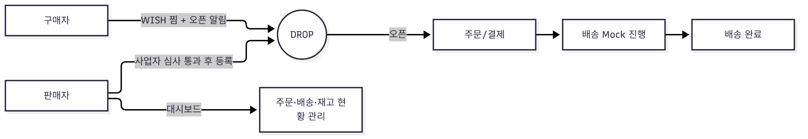
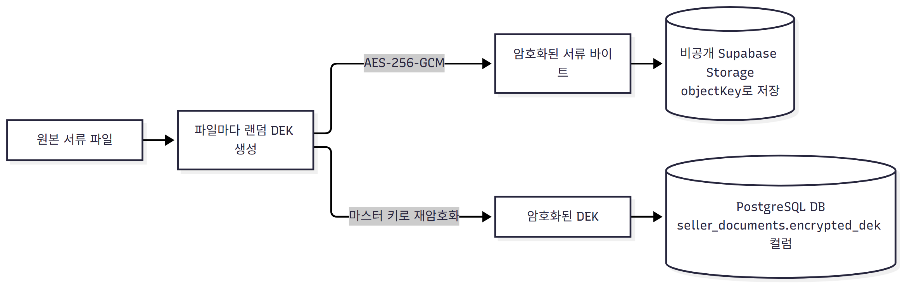
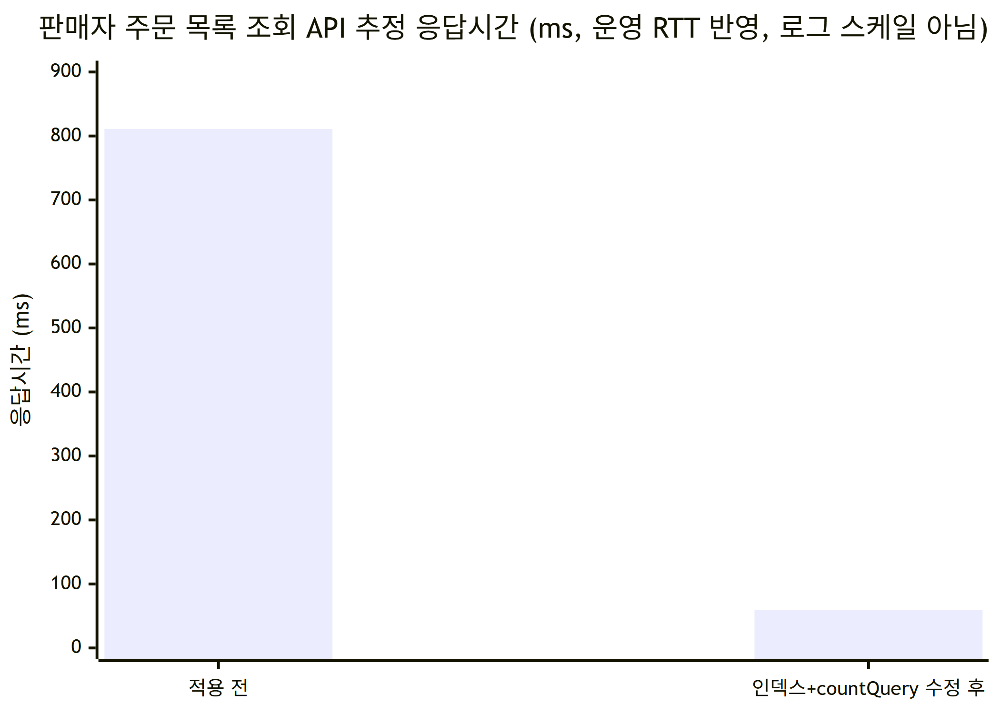

# GRAB — 한정 판매(DROP) 이커머스 플랫폼

> 부트캠프 최종 프로젝트, 4인 팀. 이 README는 팀원 중 **sangmin(sang9831)** 이 자신의
> 작업을 기준으로 정리한 개인 포트폴리오용 문서다.

## 한눈에 보기

| 항목 | 내용 |
| --- | --- |
| 서비스 | 한정 수량 판매(DROP) 커머스 — "기다림은 짧게, 기회는 단 한 번" |
| 팀 구성 | 4인 (부트캠프 최종 프로젝트) |
| 담당 역할 | 판매자(셀러) 도메인 백엔드 + 배포·인프라 |
| 핵심 과제 | DROP 오픈 순간의 트래픽 폭주에도 재고 동시성 유지 |
| 대표 성과 | 셀러 주문 조회 API 응답시간 **약 810.9ms → 59.1ms (13.7배)** |



## 담당 역할

**판매자(셀러) 도메인 백엔드 + 배포/인프라**를 담당했다.

| 영역 | 작업 내용 |
| --- | --- |
| 판매자 심사 | 국세청 사업자등록 상태조회 연동, 서류 암호화 저장 |
| 판매자 대시보드 | 요약 통계, DROP별 판매 통계, 임박 DROP API |
| 주문·배송 | 판매자 주문·배송 조회/처리 API, 배송 단계 Mock 자동 진행 |
| 알림 | WISH 알림 메일(판매 임박/시작/취소) 발송 |
| 성능 | k6 부하테스트 설계·실행 (DB 인덱스, 쿼리 합치기, 동시성 제한) |
| 배포·인프라 | Nginx Blue/Green 무중단 배포 + GitHub Actions CD, Grafana/Prometheus 모니터링 |

## 기술 스택

<p>
  
  
  
  
  
  
  
  
  
  
  
</p>

## 핵심 구현 내용

### 1. 실제 택배사 연동 없이 배송 흐름을 Mock으로 재현

**문제**: 부트캠프 프로젝트라 실제 택배사 API로 송장번호를 발급·조회할 방법이 없다.
그렇다고 배송 상태를 멈춰두면 결제 → 배송 → 완료로 이어지는 주문 흐름 전체를
시연·테스트할 수 없다.

**해결**: 판매자가 입력하는 운송장 정보는 그대로 받되, 그 이후 단계 전이는 서버가
시간 경과에 따라 스스로 진행시킨다.

판매자가 `carrier`/`trackingNumber`를 직접 입력해 `SHIPPED` 상태로 등록하면, 이후
`COLLECTED → LINE_HAUL_OUT → LINE_HAUL_IN → OUT_FOR_DELIVERY → DELIVERED` 순서로
`stage-interval`(기본 30초)마다 스케줄러가 자동으로 한 단계씩 전진시킨다. 택배사
API 콜백 없이도 운영 배송 흐름과 똑같은 상태 전이를 재현하는 셈이다.

| 구성요소 | 역할 |
| --- | --- |
| `ShipmentRegisterRequest(carrier, trackingNumber)` | 판매자가 택배사명·송장번호를 직접 입력 (실제 택배사 조회·검증은 하지 않음) |
| `ShipmentProgressScheduler` | `poll-interval`(기본 10초)마다 깨어나 전이 대상을 찾음 |
| `ShipmentProgressBatchService` | 실제 단계 갱신을 별도 빈에서 트랜잭션으로 처리 |
| `grab.mock-delivery.enabled` | 운영 택배사 연동 전까지만 켜두는 기능 플래그 |

> self-invocation 문제: 같은 서비스 안에서 메서드를 호출하면 `@Transactional`이
> 프록시를 거치지 않아 적용되지 않는다. 그래서 배치 처리(`ShipmentProgressBatchService`)를
> 별도 빈으로 분리해 프록시를 타도록 구조를 나눴다.

### 2. 민감 서류(사업자등록증 등) 암호화 저장

**봉투 암호화(envelope encryption)** 방식으로 `DocumentEncryptionService`를 구현했다.



| 보안 요소 | 처리 방식 |
| --- | --- |
| 암호화 알고리즘 | AES-256-GCM |
| 키 구조 | 파일별 랜덤 DEK + 마스터 키(환경변수)로 DEK 재암호화 |
| IV | 호출마다 `SecureRandom`으로 생성, 암호문 앞에 연결 |
| 변조 검증 | GCM 태그(128비트) |
| 암호화된 서류 바이트 저장 | 비공개 Supabase Storage 버킷 (`DocumentStorage`, 공개 URL 미발급), `objectKey`로 조회 |
| 암호화된 DEK 저장 | **DB**(`seller_documents.encrypted_dek` 컬럼) — 오브젝트 스토리지가 아니라 서류 메타데이터와 같은 행에 저장 |
| 열람 권한 | 운영자 전용, presigned URL 미사용 — 서버가 매 요청마다 복호화 + 워터마크 합성 후 응답 |
| 열람 로그 | `SellerDocumentAccessLog`에 기록 |
| 추가 마찰 | 프론트엔드 캡처 방지(우클릭/드래그 방지 등) |

`ImageStorage`(공개 상품 이미지)와 달리 `DocumentStorage`는 공개 URL을 아예 만들지
않는 것이 핵심 차이다. 서류 열람은 `SellerDocumentViewService`가 요청마다 복호화 +
워터마크(열람자·시각) 합성까지 끝낸 이미지 바이트를 직접 응답한다.

### 3. k6 부하테스트 기반 성능 개선

> 원칙: **캐시나 인덱스를 추가하기 전에 먼저 부하테스트로 병목을 확인한다.**
> 운영 환경(t3.small 추정)보다 열악한 t3.nano/micro 스펙으로 제한한 로컬 Docker
> 환경에서 측정해 "이 정도로 약한 환경에서도 재고 동시성이 깨지지 않는가"를
> 기준으로 삼았다.

| 시나리오 분류 | 예시 |
| --- | --- |
| 조회 부하 | 판매자 주문/대시보드 조회 |
| 자원 고갈 | DB 커넥션 풀 고갈, 로그인 폭주 |
| 장시간(soak) | 결제 배치 soak, 배송 진행 배치 soak |
| 장애 주입 | PG 장애 주입 |
| 폭주 | WISH 메일 폭주, 드롭 상태 전이 배치 |

실측치는 전부 `Backend/k6/`의 각 시나리오 `result.md`에 있다(아래 "성능 개선" 절
참고). k6 실행 중에는 Prometheus + Grafana 모니터링 스택(`Backend/monitoring/`)으로
백엔드 CPU/메모리/GC, HikariCP 커넥션 풀 상태를 실시간으로 보면서 포화 시점을
대시보드로 확인했다.

| 개선 항목 | 내용 | 결과 |
| --- | --- | --- |
| 주문 생성 쿼리 합치기 (GR-202) | 재고 잠금(lock)+증가(increase) 쿼리를 조건부 `UPDATE ... RETURNING` 하나로 통합 | 락 보유 구간 DB 왕복 1회 감소 |
| 동시 실행 전역 상한 | 주문 생성에 세마포어 적용(acquire-timeout 3초 초과 시 503), `maxConcurrent` 10/15/20/100 비교 측정 | 10·15는 거절 112·96건에 p95 3.73s·4.94s(과도한 제한), 100은 p95 4.08s(사실상 무제한과 동일), **20**은 거절 0건·p95 1.36s로 최적 |
| 셀러 주문 조회 (GR-191) | 아래 "성능 개선" 절 참고 | 약 **13.7배** 개선 |

## 성능 개선

### 판매자 주문 목록 조회 — 인덱스 + countQuery 최적화 (GR-191)

주문이 많아질수록(15만 건 규모) `findSellerOrders`가 느려지는지 확인하기 위해
전용 벤치마크를 돌렸다. 본문 쿼리는 인덱스(`idx_orders_drop_created`) 추가로
크게 빨라졌지만, 실제 API 응답은 거의 개선되지 않았다 — 원인은 페이지네이션용
`countQuery`가 `paymentStatus` 필터가 없어도 매 행(15만 건)마다 `LEFT JOIN LATERAL`로
결제 최신 상태를 조회하고 있었기 때문이다. `ON TRUE` 조건을
`ON CAST(:paymentStatus AS VARCHAR) IS NOT NULL`로 바꿔 필터가 없을 때는 LATERAL
서브쿼리 자체를 건너뛰도록 고쳤다.

| 구간 | 적용 전 | 적용 후 | 비고 |
| --- | ---: | ---: | --- |
| 본문 쿼리(EXPLAIN ANALYZE) | 78.1ms (Parallel Seq Scan + 외부 정렬) | 0.2ms (Index Scan Backward) | 약 390배 — 단 이 수치만으로는 API 체감을 설명 못 함 |
| countQuery(EXPLAIN ANALYZE, `paymentStatus=NULL`) | 726.8ms (LATERAL 매 행 실행) | 52.9ms (`One-Time Filter: false`로 스킵) | 약 14배 |
| API 추정치(운영 Supabase RTT 3ms × 2회 왕복 포함) | 약 810.9ms | 약 59.1ms | **약 13.7배** |

"본문 쿼리만 390배 빨라졌다"는 countQuery 병목을 가리는 과장된 비교였고, 두 최적화를
모두 반영한 API 기준 개선폭인 **약 13.7배**가 실제 체감에 가까운 수치다.



### 평상시 조회 하한선 (캐시 없는 상태, GR-173·GR-174)

대시보드·주문 조회는 아직 뚜렷한 병목이 아니라는 것도 부하테스트로 확인했다(모두
micro 스펙, VU 20, 30초, 체크 성공률 100%).

| 시나리오 | p95 (steady-state) | p95 (오픈 스파이크 겹침) |
| --- | ---: | ---: |
| 대시보드 요약(`summary_read`) | 28.18ms | - |
| DROP별 통계(`drop_stats_read`) | 24.39ms | - |
| 판매자 주문 목록(`list_read`) | 37.63ms | 49.64ms (+32%) |
| 판매자 주문 상세(`detail_read`) | 30.94ms | 30.8ms (영향 없음) |

주문이 실시간으로 쌓이는 동안 목록 조회(`created_at DESC` 정렬)는 쓰기 트랜잭션과
경합해 p95가 올라가지만, 단건 조회인 상세는 영향이 거의 없었다. 수치는 모두
`Backend/k6/seller-dashboard/result.md`, `Backend/k6/seller-order-read/result.md`에서
가져온 실측값이다.

## 트러블슈팅 — GR-69 메일 발송

### 문제

알림과 인증 코드가 **같은 Gmail 계정 + 같은 스레드 풀**을 공유하고 있었다.

- Gmail 무료 계정은 500 recipients/일
- 알림은 수신자당 2통(임박 + 시작) → WISH 250명짜리 DROP 하나로 하루치 소진
- 한도를 넘기면 최대 24시간 발송 차단 → **알림 한 번이 회원가입을 하루 막는다**
- 스레드 풀도 공유라, 알림 묶음 작업이 풀을 점유하면 인증 코드가 큐에서 대기

핵심: 치명도가 다른 두 경로가 같은 자원을 두고 경쟁하고 있었다. 알림은 못 가도 서비스가 멈추지 않지만, 인증 코드는 그렇지 않다.

### 결정 1 — 발송처 분리, 그리고 스레드 풀도 분리

|  | 설정 | 로컬 | 배포 |
| --- | --- | --- | --- |
| 인증 코드 | `spring.mail` (`MAIL_*`) | Mailpit | Gmail 500통/일 |
| WISH 알림 | `grab.mail.notice` (`BREVO_*`) | Mailpit | Brevo 300통/일 |

`BREVO_SMTP_HOST`가 비면 기본 발송기를 그대로 돌려준다. **호출하는 쪽에 분기가 없고**, 로컬은 설정 없이 Mailpit으로 나간다. 배포는 환경변수 한 줄로 전환.

#### 처음엔 부수 효과로 끝난 줄 알았다

알림이 `dispatchAll()`로 DROP 하나당 작업 1개(수신자는 BCC로 묶음)만 만들다 보니, 공용 풀(4스레드)에서 알림이 쓰는 스레드가 거의 항상 1개뿐이었다. 그래서 처음엔 "풀 4 / 큐 40 값을 안 고치고 문제가 사라졌다"고 정리했다.

#### 그런데 잔여 리스크가 남아 있었다

스케줄러가 한 번 돌 때 배치 크기(500)를 넘는 DROP이 전환되면 `drain()`이 여러 번 반복되고, 그때마다 임박·시작 이벤트가 따로 발행돼 `dispatchAll()`도 여러 번 호출된다. 세일 오픈이 몰리는 시간대엔 한 tick에 이게 여러 건 겹칠 수 있어서, "알림이 보통 스레드 1개만 쓴다"는 건 **관찰된 패턴이지 보장된 동작이 아니었다.** 몰리면 공용 풀 4개를 알림이 전부 채우고, 그 순간 들어온 인증 코드 요청은 큐에서 대기하거나 거부된다 — 처음 문제 정의로 그대로 돌아가는 경로가 남아 있던 것.

#### 그래서 풀을 물리적으로 나눴다

|  | 스레드 | 큐 용량 | 큐 용량 산출 근거 |
| --- | --- | --- | --- |
| `authMailTaskExecutor` | 4 | 40 (4 × 30초 ÷ 3초) | 작업 하나 = 메일 1통. 거부돼도 사용자가 재발송 간격 뒤 재시도(MEMBER_AUTH 1.2.1) |
| `noticeMailTaskExecutor` | 1 | 100 | 작업 하나 = DROP 1개(BCC 수백 명). 동시 전환 DROP 수는 거의 1~2개라 스레드 1개로 충분. 큐는 재시도 경로가 없어 유실이 더 치명적이므로 넉넉히 |

두 풀은 스레드뿐 아니라 큐도 완전히 독립된 `ThreadPoolTaskExecutor` 빈이라, 한쪽이 몰려도 다른 쪽에 전혀 영향을 주지 않는다. `AsyncEmailDispatcher`에서 인증 코드 경로(`dispatch()`)는 `authMailTaskExecutor`, 알림 경로(`submit()`/`dispatchAll()`)는 `noticeMailTaskExecutor`만 쓰도록 나눴다.

인증 쪽 숫자(4스레드, 큐 40)는 기존 그대로 유지해 회귀 리스크가 없고, 알림 쪽 큐 용량(100)은 실측이 아니라 "한 tick에 몰릴 수 있는 극단치에 대한 여유값"이라 실제 피크를 재면 바꿔야 한다.

배운 것: "공용 자원인데 우연히 안 부딪힌다"는 상태는 트래픽 패턴이 바뀌는 순간 깨질 수 있다. 관찰로 괜찮아 보여도, 치명도가 다른 두 경로라면 자원을 구조적으로 분리해 그 가정 자체를 없애는 쪽이 맞았다.

### 결정 2 — 발송 대행은 Brevo

**도메인 보유 여부가 선택지를 갈랐다.** 도메인이 없어서 개별 발신 주소 검증을 지원하는 곳만 후보.

| 서비스 | 무료 한도 | 도메인 없이 |
| --- | --- | --- |
| **Brevo** | 300통/일 | 가능 — **채택** |
| SMTP2GO | 200통/일 | 불가 (도메인 필수) |
| Mailjet | 200통/일 | 문의해서 프로젝트 검증 받아야 함 |
| Resend | 100통/일 | 불가 (도메인 필수) |
| SES 샌드박스 | 200통/일 | 불가 (검증된 주소로만) |
| SES 프로덕션 | 50,000통/일 | 불가 (신청 승인 필요) |

배운 것:

- **무료 티어 중 Gmail 500통/일을 이기는 게 없다.** 바꿔서 얻는 건 할당량이 아니라 계정 분리와 도달률
- **배포 주소는 도메인이 아니다.** EC2가 주는 `.compute.amazonaws.com`은 AWS 소유라 DNS 레코드를 못 넣는다
- `@gmail.com`은 인증 대상이 아니다 (2024-02 Gmail/Yahoo 발신자 요건)

타협: 도메인이 없어 발신 주소가 `@brevosend.com`으로 나간다. 도메인(연 1,000~5,000원)을 사면 **코드 변경 없이** 해소된다.

### 결정 3 — Redis 쿼터 라우터는 만들었다 지웠다

발송처를 여럿 엮어 한도를 합치려 했는데, **반응형 폴백이 작동하지 않는다**는 걸 발견했다.

Brevo·Mailjet은 한도를 넘겨도 SMTP 오류를 안 준다. 재시도 큐에 넣고 **성공으로 응답**한다. "실패하면 다음 발송처"라는 설계가 실패를 받지 못해 안 돌아간다.

해결: 보낸 통수를 Redis에 직접 세고, 한도에 닿으면 응답과 무관하게 **미리** 다음 발송처로 넘긴다. 덤으로 테스트도 가능해진다(Redis에 280을 넣으면 끝).

주의할 점: 쿼터는 **UTC 자정**에 리셋된다(한국 시간 오전 9시). KST 날짜로 카운터를 만들면 00~09시 구간에 우리 카운터만 먼저 리셋돼 한도를 넘겨 보낸다.

**그런데 지웠다.** Mailjet이 막히면서 발송처가 Brevo 하나만 남았고, 하나면 라우팅이 의미가 없다. 남는 기능이 "280에서 끊고 버리기"뿐인데 그걸 위해 라우터 110줄 + 테스트 170줄 + Redis 의존을 유지할 이유가 없었다.

포기한 것: 300통을 넘기면 Brevo가 다음 날 보낸다. 수신자당 2통이라 **하루 150명분**이 실질 한도.

### 결정 4 — 청크 분할을 빼고 BCC

원래는 목록을 풀 크기(4)만큼 청크로 나눠 동시 발송했다. 되살리려니 **첫 질문의 문제가 그대로 돌아왔다** — 알림이 스레드 4개를 다 쓰면 인증 코드가 최대 50초 대기(전제는 30초).

#### 실측 (Brevo SMTP)

플러스 주소(`tjfl9831+b1@…`)로 재서 같은 받은편지함으로 받으면서 SMTP에는 다른 수신자로 잡히게 했다.

| 항목 | 값 |
| --- | --- |
| 연결 고정비 | 1.72초 |
| 메시지 고정비 | 0.72초 |
| 개별 발송 통당 | **0.643초** |
| BCC 수신자당 | **0.134초** |

**4.8배 차이.** 통마다 보내면 수신자당 `MAIL FROM`·`RCPT`·`DATA`·본문을 모두 반복하지만, BCC는 수신자당 `RCPT` 한 번으로 끝난다.

#### 방식별 비교

| 수신자 | 개별·1연결 | 청크 2 | 청크 4(풀 6) | **BCC·1연결** |
| --- | --- | --- | --- | --- |
| 100 | 66.0초 | 33.9초 | 17.8초 | **15.8초** |
| 300 | 194.6초 | 98.0초 | 49.9초 | **44.1초** |
| 스레드 | 1 | 2 | 4 | **1** |
| SMTP 연결 | 1 | 2 | 4 | **1** |

**BCC 단독이 4분할보다 빠르면서 스레드·연결은 1개만 쓴다.** 인증 코드 간섭도, Brevo 동시 연결 한도 걱정도 사라졌다.

묶을 수 있었던 이유: 같은 DROP의 수신자는 **본문에 개인화 요소가 하나도 없다.** DROP 이름·링크가 DROP 단위라 받는 메일이 바이트까지 동일하다.

#### 빠진 함정 — 받는 사람 칸에 실제 주소를 넣지 말 것

처음 구현은 받는 사람 칸이 비면 클라이언트가 수신자를 표시하지 못할까 봐 **발신 주소를 To에 넣었다.** 그런데 **SMTP는 To와 BCC를 모두 수신자로 쓴다.**

`BCC 100명 묶음 → 실제 수신자 101명`

세 가지가 깨졌다.

1. 발송처 계정 메일함에 알림 사본이 계속 쌓인다
2. 일일 한도를 메일마다 1통씩 더 쓴다 — Brevo도 수신자 수로 센다
3. 메시지당 수신자 상한(Gmail 기준 100)을 넘긴다 — **100에 맞춰 끊어둔 묶음이 101이 돼 거부될 수 있었다**

고침은 실제 주소가 없는 그룹 구문을 To 헤더에 직접 넣는 것. 표시는 채워지고 수신자는 0명이다.

```
From: no-reply@grab.local
To:   undisclosed-recipients:;
Bcc:  a@example.com, b@example.com
```

**Mailpit으로는 이걸 못 잡는다.** SMTP 트랜잭션 단위로 1건을 저장해서 수신자 수가 안 보인다. **GreenMail은 수신자마다 메시지를 하나씩 돌려준다** — BCC 2명에 3건이 오는 걸로 잡았다.

#### 필수 설정

`spring.mail.properties.mail.smtp.sendpartial: true`

JavaMail 기본값이 `false`라, **BCC 100명 중 한 주소가 거부되면 100명 전원에게 안 간다.**

#### 내준 것

| 도달률 | `undisclosed-recipients` + 동일 본문 대량 = 스팸 시그널 |
| --- | --- |
| 수신 거부 링크 | 개인별 토큰을 못 넣는다 → opt-out 이슈와 충돌 |
| 바운스 추적 | 어느 주소가 반송됐는지 구분 어려움 |
| 실패 단위 | 1명 → 최대 100명 |
| 일일 한도 | **전혀 안 줄어든다** (Brevo도 수신자 수로 셈) |

BCC 10명 테스트 메일은 받은편지함에 정상 도착했다. 다만 100명도 같은 결과일지는 별개.

### 남은 과제

#### 배포 전

- `BREVO_SMTP_HOST` / `PORT` / `USERNAME` / `PASSWORD` / `MAIL_FROM` 주입
- `WEB_BASE_URL` 주입 — 빼먹으면 메일 링크가 `localhost`를 가리킨다
- 기동 로그가 `알림 메일 발송처 등록: host=smtp-relay.brevo.com`으로 바뀌는지 확인

#### 미해결

| 항목 | 상태 |
| --- | --- |
| 도메인 미보유 | 발신 주소가 `@brevosend.com` |
| 수신 거부(opt-out) | 별도 이슈. **BCC 묶음과 충돌** |
| 100명 BCC 도달률 | 10명만 확인 |
| Brevo 메시지당 수신자 상한 | 비공개. Gmail 기준 100으로 운용 |

#### 언제 다시 볼까

| 신호 | 할 일 |
| --- | --- |
| 수신자 150명 초과 | 발송처 추가 또는 SES 프로덕션 |
| 알림이 스팸함으로 간다 | 도메인 구매 → SPF/DKIM 정렬 |
| opt-out 구현 | BCC 묶음을 풀지 말지 먼저 결정 |
| 알림 풀 큐(100)가 자주 참 | 실제 피크 작업 수를 로그로 측정해 큐 용량 재산정 |

## 실행 방법

```bash
# Backend 디렉터리에서
cp .env.example .env   # JWT_SECRET, SELLER_DOCUMENT_ENCRYPTION_MASTER_KEY 등 필수 값 채우기
docker compose up --build
```

- 기본 포트: 백엔드 `8080`, PostgreSQL/Redis는 compose 내부 네트워크로 연결.
- k6 부하테스트는 `Backend/k6/README.md`를 참고(로컬 전용, 외부/운영 대상 금지).

## 더 보기

- [Backend/k6/README.md](./Backend/k6/README.md) — 전체 부하테스트 시나리오 목록·결과
- [Backend/docs/development/](./Backend/docs/development/) — API 명세, ERD, 기술 스택 결정 기록
